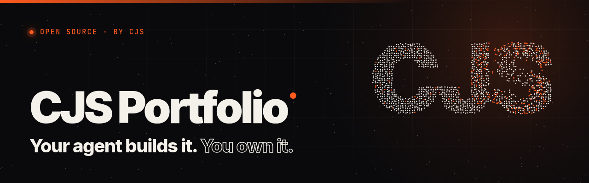
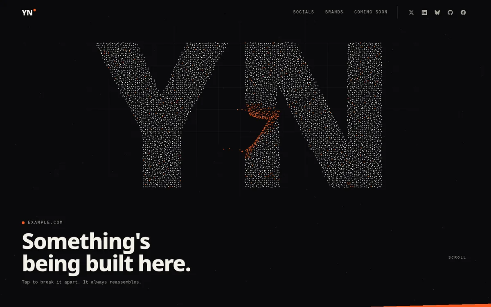
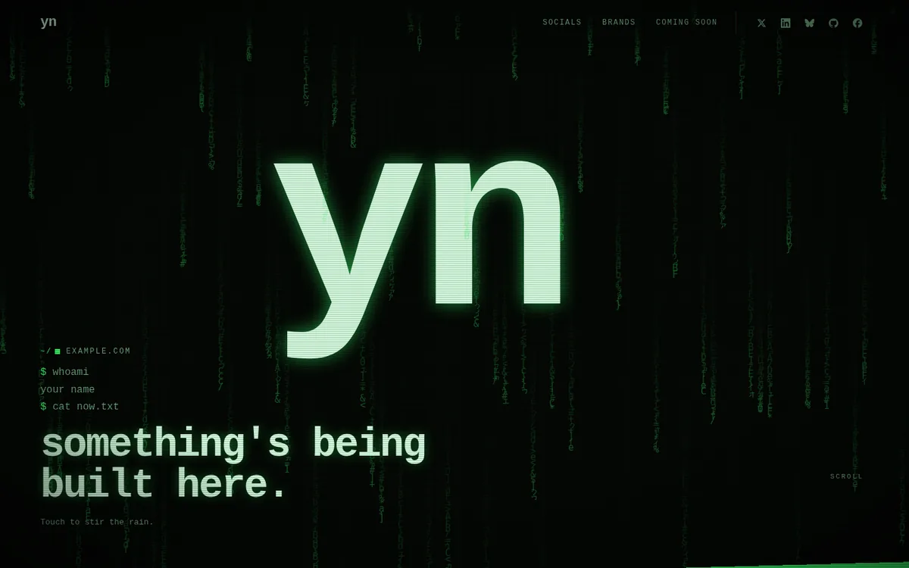
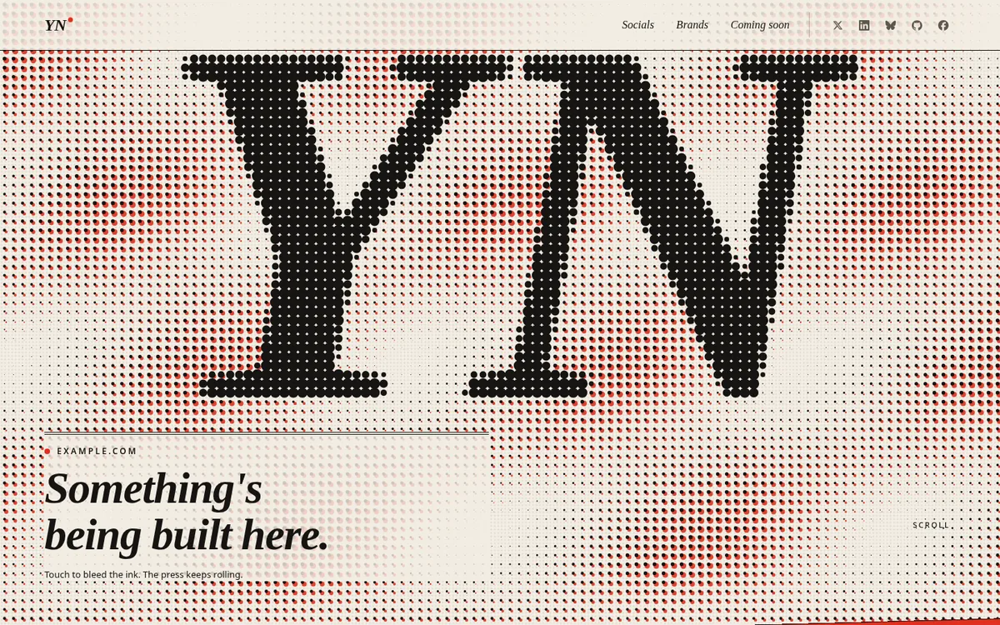
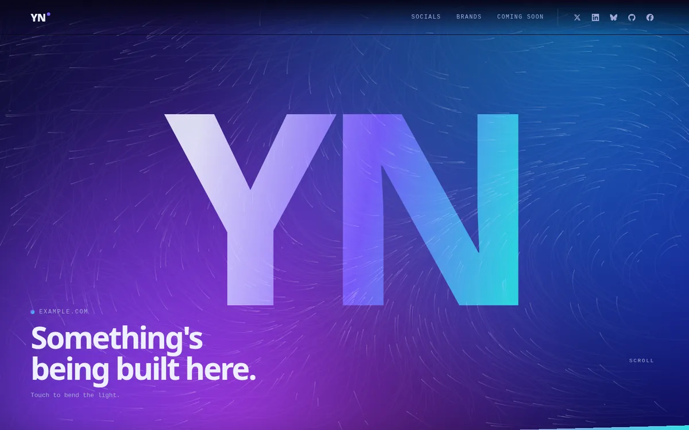
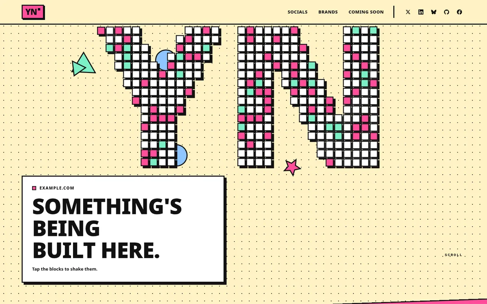
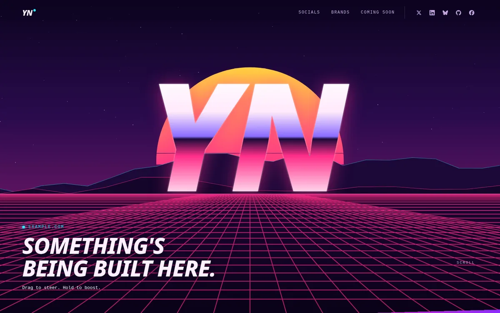
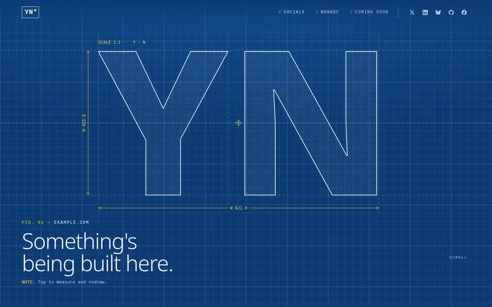

<p align="center">
  
</p>

# CJS Portfolio

**Your agent builds it. You own it.** A one-page personal site template with an [`AGENTS.md`](AGENTS.md) that any coding agent can follow, from the first question to the deploy.

You fill in one JSON file (or let your agent interview you and fill it in). One small Node script with zero dependencies turns it into a fast static site you can host anywhere.

**Pick a look first:** try all 7 themes with your own initials and colour in the **[theme tester](https://cjandren.com/themes/)**, then paste the prompt it gives you into your agent.



## Themes

Seven themes, one config key. Every theme shows the same content and sections, has its own hero effect, respects `prefers-reduced-motion`, and scores 99–100 in Lighthouse on mobile and desktop. Only the theme you choose is built into your site.

| | Theme | Hero | Default accent |
|---|---|---|---|
|  | **`signal`** (default) | Dark. Your initials in a few thousand particles that scatter around the cursor and spring back; a click sends a shockwave. | `#ff5b1f` |
|  | **`terminal`** | Phosphor CRT. Glyph rain, scanlines, and your intro typed out as a shell session. | `#39ff6a` |
|  | **`paper`** | Light editorial print. Halftone initials in serif ink with an off-register colour plate that rolls like a press. | `#e0301e` |
|  | **`aurora`** | Northern lights. Drifting colour glow and flowing light trails that bend around the cursor, with frosted-glass cards. | `#7c5cff` |
|  | **`brutal`** | Neo-brutalist poster. Chunky block initials with hard shadows that you press like buttons; a click shakes them up. | `#ff4f9a` |
|  | **`synth`** | Synthwave sunset. A neon grid rushes toward a striped sun behind chrome initials; steer it, hold to boost. | `#ff2e88` |
|  | **`blueprint`** | Technical drawing. Your initials are plotted with construction lines, hatching and dimensions; the cursor measures. | `#ffd23f` |

Choose one in `site.config.json`:

```json
"theme": "paper",
"accent": ""
```

`"accent": ""` uses the theme's default; any 6-digit hex overrides it. Then run `npm run assets && npm run build`. Each theme lives in `src/themes/<name>/` (`theme.json`, `theme.css`, `hero.js`). Once you've picked one you can delete the others; your agent does this for you (see [`AGENTS.md`](AGENTS.md), which also holds the exact spec for each theme).

## Features

- **Seven themes, each with its own interactive hero.** Particles, glyph rain, halftone print, aurora light, press-able blocks, a synthwave grid or a blueprint drawing (see [Themes](#themes)). All canvas and CSS, no libraries.
- **Decode teaser line.** The tagline under the hero decodes from random glyphs on load. The nav links do the same on hover.
- **Socials tiles with sparks.** Big outlined network names that fill in on hover, plus an accent-coloured spark burst and a decoding handle. Includes 17 built-in icons (X, LinkedIn, Bluesky, GitHub, Facebook, Instagram, YouTube, Mastodon, Threads, TikTok, Dribbble, Medium, Substack, Twitch, Discord, website and email).
- **Company and brands.** An optional parent-company panel plus brand cards with a category, a status dot (live, soon or planned) and a link.
- **"Coming soon" cards** for the sections you haven't built yet, and a **404 page** in the same hero style.
- **SEO and AI discoverability.** Meta, Open Graph and Twitter tags, a JSON-LD graph (WebSite, ProfilePage, Person, Organization, Brands), `sitemap.xml`, `robots.txt` with an explicit AI-crawler allowlist (you can switch it to a blocklist), `llms.txt` + `llms-full.txt`, `humans.txt`, a web manifest, an SVG favicon and PNG icons.
- **Fast by construction.** No frameworks, web fonts or third-party requests (Google Analytics is opt-in, see [Analytics](#analytics-optional)). The CSS is inlined behind a CSP hash. The JavaScript is about 4 KB brotli-compressed and the hero effect boots after first paint. Every asset URL is cache-busted with a content hash, and text files are precompressed (`.br`/`.gz`).
- **Accessible.** Real headings and landmarks, a skip link and visible focus. Screen readers get your full name instead of the initials. `prefers-reduced-motion` gets a still hero with no animation. Accessibility scores 100 in every theme.
- **One accent.** Change one hex value and the accent updates everywhere: CSS, the hero, sparks, favicon and share image.

## Quick start

Requires Node 18+. Chrome or Chromium is only needed to re-render the share image and icons.

```sh
git clone https://github.com/theseige/cjs-portfolio my-site && cd my-site
# edit site.config.json: set "theme" and your content   (or open the folder in your coding agent and say: "follow AGENTS.md")
npm run assets            # re-render og.jpg + icons from your name/initials/accent (needs Chrome)
npm run build             # -> dist/
npm run serve             # http://localhost:8080 (with brotli, cache headers and the 404 page)
```

There is nothing to `npm install`.

### With a coding agent

Open the repo in Claude Code, Cursor, Codex, Copilot, Windsurf or any other agent and say:

> Set up my site by following AGENTS.md.

Or paste the prompt from the [theme tester](https://cjandren.com/themes/), e.g.:

> Use theme: paper, accent: #e0301e in theseige/cjs-portfolio

The agent first sends you to the theme tester (if you haven't picked a theme yet; it uses Signal if you don't). Then it asks for your name, links and brands. It fills in the config, builds, checks the result (including Lighthouse) and walks you through the deploy. [`AGENTS.md`](AGENTS.md) also tells it what it must never do, such as inventing facts about you. `CLAUDE.md`, `.cursorrules` and `.github/copilot-instructions.md` all point to it.

## Config reference

Everything lives in [`site.config.json`](site.config.json). Text values are plain text, and HTML is escaped.

| Key | Required | What it does |
|---|---|---|
| `name` | yes | Your full name. Used in the title, the screen-reader heading, JSON-LD, the footer and the share image |
| `initials` | yes | The word drawn by the hero, the logo mark and the favicon. 1–3 characters look best |
| `url` | yes | Your https origin, e.g. `https://example.com`. Used for canonical, sitemap, OG and robots |
| `title` / `description` | yes | `<title>` and meta description (also OG/Twitter). Keep the description around 150 characters |
| `theme` | no | `signal` (default), `terminal`, `paper`, `aurora`, `brutal`, `synth` or `blueprint`. The folder `src/themes/<theme>/` must exist |
| `accent` | no | 6-digit hex colour, or `""` for the theme's default accent |
| `lang` / `locale` | no | Default to `en` / `en_US` |
| `jobTitle`, `personDescription` | no | JSON-LD Person fields. Only use them if they are true and you want them public |
| `firstName` / `lastName` | no | Overrides for `profile:*` tags. By default the name is split at the first space |
| `hero.kicker` | no | Small mono line above the tagline (defaults to your domain) |
| `hero.tagline` | no | The decoding teaser line |
| `hero.hintPointer` / `hintTouch` / `hintAfter` | no | Overrides the theme's small hint under the tagline for mouse and touch users |
| `marquee` | no | Array of short phrases for the accent ticker. Use `[]` to hide it |
| `socials.items[]` | no | `{ network, handle, url, label? }`. `network` is one of the keys in `src/icons.json`. `url` must be `https://` or `mailto:` |
| `brands.company` | no | `{ name, suffix, url, eyebrow, description, note, cta }`, the big parent-company panel |
| `brands.items[]` | no | `{ name, category, description, status, state, url, linkLabel }`. `state` is `live` (green dot), `soon` (amber) or anything else (grey) |
| `soon.items[]` | no | `{ title, label }` for the "coming soon" cards |
| `socials` / `brands` / `soon` → `nav`, `eyebrow`, `title`, `titleOutline` | no | Nav label, small section label, and the two-line heading (the second line is outlined) |
| any section → `"enabled": false` | no | Hides the section, its nav link and its llms.txt entries. Sections are renumbered automatically |
| `footer.big` / `footer.copyright` | no | The huge outlined footer line and the © name |
| `notFound.kicker` / `notFound.tagline` | no | The 404 page text |
| `seo.twitter` | no | `@handle` for `twitter:site`/`creator` |
| `seo.username` | no | `profile:username` |
| `seo.ogLine` | no | The grey line under your name on the share image |
| `seo.ogImageAlt` | no | Alt text for the share image |
| `seo.llmsSummary` | no | The one-line summary at the top of `llms.txt` |
| `seo.allowAICrawlers` | no | `true` (default) lists the AI crawlers with `Allow: /`. Set it to `false` to `Disallow` them |

After changing `name`, `initials`, `theme`, `accent`, `url` or `seo.ogLine`, run `npm run assets` and then `npm run build`. The build warns you if you forget.

### Project layout

```
site.config.json        all your content
site.local.example.json optional Google tag ID template (copy to the gitignored site.local.json)
src/styles.css          shared base styles (the Signal look; accent swapped at build time)
src/main.js             decode, sparks, reveals, spotlight (vanilla JS)
src/themes/<name>/      theme.json + theme.css + hero.js; only the chosen theme is built
docs/                   theme screenshots
src/icons.json          social icons (Simple Icons, CC0)
src/assets.html         draws og.jpg + icons (used by npm run assets)
static/                 copied into dist/ as-is (og.jpg, PNG icons)
scripts/build.mjs       config -> dist/ (HTML, SEO files, hashing, CSP, precompression)
scripts/assets.mjs      renders static/og.jpg + icons with headless Chrome
scripts/serve.mjs       local preview that behaves like production
deploy/deploy.sh        build -> backup -> rsync -> live checks
deploy/Caddyfile.example
media/                  logo + launch graphics (see media/README.md)
```

## Analytics (optional)

Off by default: with no ID the build has no tracking code and the strict default CSP. To add your own Google tag (GA4):

```sh
cp site.local.example.json site.local.json   # put your measurement ID in it: {"analytics": {"googleTagId": "G-XXXXXXXXXX"}}
npm run build                                # or: GOOGLE_TAG_ID=G-XXXXXXXXXX npm run build
```

Get the ID at [analytics.google.com](https://analytics.google.com): **Admin → Data streams → Web → Measurement ID** (starts with `G-`). The build checks the format and fails on anything else. It then adds the async `gtag.js` loader plus a first-party `/ga.js` (no inline script) to every page and widens the CSP in `dist/_headers` to Google's GA4 hosts. On your own server, use the same CSP (commented line in [`deploy/Caddyfile.example`](deploy/Caddyfile.example)).

`site.local.json` is gitignored. The ID isn't secret, since it is public in the built HTML, but keeping it out of git means forks and copies of your repo don't send their visitors to your analytics. Depending on your visitors (e.g. the EU/UK), you may need a cookie banner or consent mode. That is up to you, and the template doesn't add one.

## Deploy

`dist/` is plain static files, so any static host works.

**Your own server (rsync over SSH).** The script builds in strict mode, which refuses placeholder content. It backs up the live site to `backups/<timestamp>/`, uploads with `rsync --delete`, then checks that the live HTML references the new asset hash.

```sh
DEPLOY_HOST=user@your-server DEPLOY_PATH=/var/www/example.com npm run deploy
# optional: SSH_KEY=~/.ssh/your_key  SKIP_BACKUP=1 (first deploy)
```

Serve it with Caddy using [`deploy/Caddyfile.example`](deploy/Caddyfile.example). It provides automatic HTTPS, `precompressed br gzip`, long-lived caching for `?v=` URLs, no-cache HTML, security headers and the 404 page. With nginx, the equivalent is `gzip_static`/`brotli_static`, `error_page 404 /404.html` and the same `Cache-Control` rules.

**Netlify / Cloudflare Pages.** Build command `npm run build`, output directory `dist`. The generated `dist/_headers` sets the cache and security headers, and both hosts serve `404.html` automatically.

**GitHub Pages / Vercel / S3 / anything else.** Run `npm run build` and upload the contents of `dist/`. Every host supports the defaults, which are: no-cache for HTML, and long caching for anything with `?v=`.

## Performance & SEO notes

- Lighthouse on the template's placeholder build, every theme: **99–100 / 100 / 100 / 100** on mobile and desktop (Performance / Accessibility / Best practices / SEO). Signal scores 100 across the board. Numbers vary with your content and host. Check your own build with `npx lighthouse https://your-domain/`.
- In every theme the home page is about 7 KB brotli-compressed with the CSS inlined, plus about 4 KB of JS. There are no render-blocking requests.
- The hero canvas starts on `requestIdleCallback` after first paint and pauses when the hero is off-screen or the tab is hidden.
- Cache-busting: `main.js`, the favicons, the manifest and the share image are referenced as `?v=<sha256 prefix>`. HTML is `no-cache`, so a deploy shows up on the next page load while everything else is cached for a year.
- The CSP `<meta>` pins `style-src` to the sha256 of the inlined `<style>`. The build computes the hash, so don't hand-edit `dist/`.
- `robots.txt` names the AI crawlers explicitly (OpenAI, Anthropic, Perplexity, Google-Extended, Apple, Common Crawl, Meta, Amazon and more). Answer engines then know they may read the site, and `llms.txt` gives them a clean summary.

## Credits

A [CJS](https://cjs.agency) project, built by [CJ Andren](https://cjandren.com). It is the open-source version of the design behind cjandren.com.

Icons come from [Simple Icons](https://simpleicons.org) (CC0). The website and email glyphs are original.

## License

[MIT](LICENSE) © 2026 CJ Andren / CJS. Make it yours.
